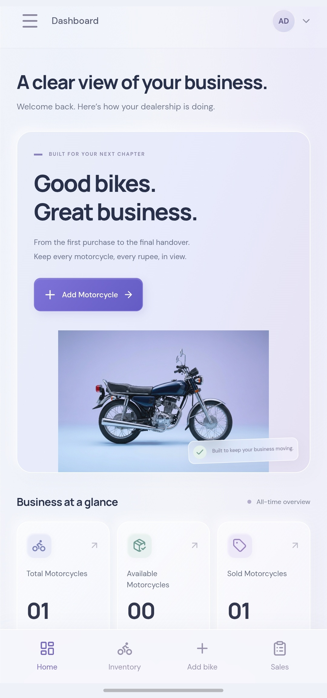
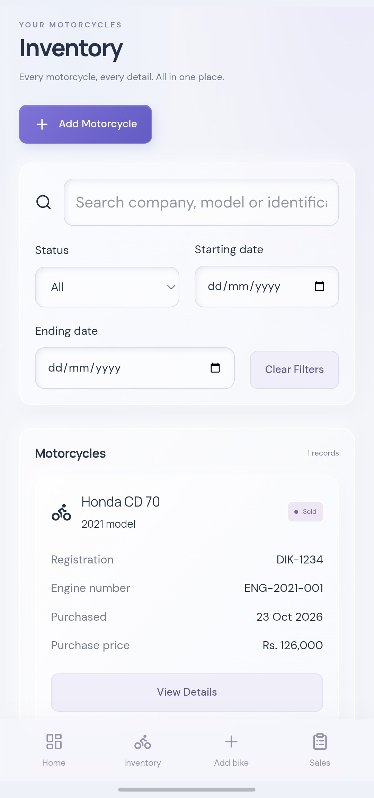
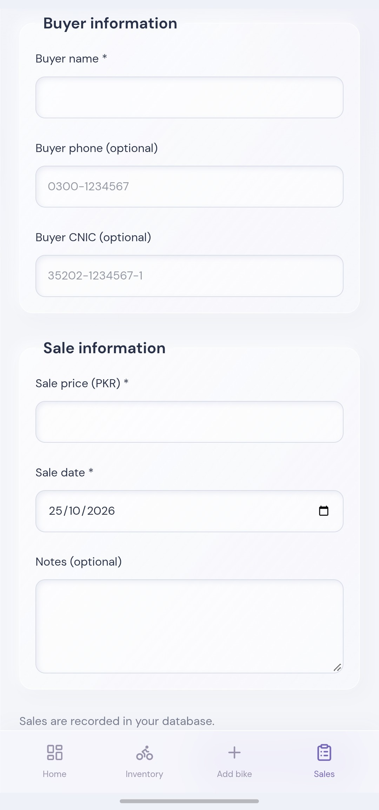
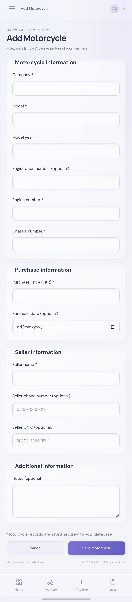

# MotoDesk — Motorcycle Shop Management Frontend

A responsive web application for managing motorcycle inventory, sales, and receipts in a small dealership.

MotoDesk started as a request from my brother, who runs a motorcycle shop and needed a simpler way to organize bikes bought and sold. This repository contains the frontend of the application, designed for everyday use on both mobile and desktop devices. It connects to a separate FastAPI backend for authentication, inventory, sales, and business statistics.

- **Live application:** [MotoDesk](https://motodesk.pages.dev)
- **Backend repository:** [bike-shop-management](https://github.com/adeel-akbar/bike-shop-management)
- **Backend API documentation:** [Swagger UI](https://motodesk.duckdns.org/docs)

> **Note:** The live application is used by a real motorcycle shop. It requires private admin credentials, and production records are not available as a public demo.

## Features

- **Admin login** — sign in to access the shop's management workspace.
- **Dashboard** — view an overview of inventory and sales activity.
- **Motorcycle inventory** — browse available and sold bikes, search records, and add or edit motorcycle details.
- **Sales management** — register a sale with buyer information and review sales records.
- **Printable receipts** — access PDF sale receipts generated by the backend.
- **Responsive layout** — use the application on phones and desktop browsers.
- **Progressive Web App (PWA)** — install MotoDesk on supported mobile devices for an app-like experience.

MotoDesk currently requires an internet connection to communicate with its backend. PWA installation does not mean the application supports offline inventory or sales operations.

## Screenshots

All screenshots use fictional test records. No real customer or shop data is shown.

<!-- markdownlint-disable MD033 -->
<table>
  <tr>
    <td align="center" valign="top">
      <br>
      <sub>Dashboard</sub>
    </td>
    <td align="center" valign="top">
      <br>
      <sub>Inventory</sub>
    </td>
    <td align="center" valign="top">
      <br>
      <sub>Record a sale</sub>
    </td>
  </tr>
</table>

<p align="center">
  <br>
  <sub>Add a motorcycle</sub>
</p>
<!-- markdownlint-enable MD033 -->

## Demo

Watch the [MotoDesk demo on LinkedIn](https://www.linkedin.com/feed/update/urn:li:activity:7521462771964887041/).

The walkthrough shows the mobile interface, from adding a motorcycle
to recording a sale and generating a PDF receipt.

The demonstration uses fictional data to protect private shop records.

## Technology Stack

| Area | Technology |
| --- | --- |
| Language | TypeScript |
| Framework | Next.js 16, React 19 |
| Client-side routing | React Router 7 |
| Styling | Tailwind CSS 4, `tw-animate-css` |
| UI components | Base UI, shadcn tooling, `class-variance-authority`, `clsx`, `tailwind-merge` |
| Icons | Lucide React |
| Data fetching | SWR and frontend API utilities |
| Package manager | pnpm |
| Hosting | Cloudflare Pages |
| Backend | FastAPI and PostgreSQL (separate repository) |

The project uses Next.js for its application setup and build, while the management screens are organized as React components under `src/`. Client-side navigation is handled by React Router.

## How It Works

```text
Mobile / Desktop Browser
         |
         v
MotoDesk Frontend (Cloudflare Pages)
         |
         | HTTPS API requests
         v
NGINX (Oracle Cloud Ubuntu VM)
         |
         v
FastAPI Backend (Docker)
         |
         v
PostgreSQL (Neon)
```

The frontend handles navigation, forms, and the user interface. The FastAPI backend handles authentication, business rules, database operations, and PDF receipt generation. Production data is not stored in the frontend repository.

## Project Structure

```text
bike-shop-management-frontend/
├── app/
│   ├── icon.svg
│   ├── layout.tsx
│   └── page.tsx
├── components/
│   └── ui/
│       └── button.tsx
├── docs/
│   └── screenshots/
├── lib/
│   └── utils.ts
├── public/
│   ├── icons/
│   │   ├── icon-192.png
│   │   └── icon-512.png
│   ├── images/
│   └── manifest.json
├── src/
│   ├── components/
│   │   ├── shell.tsx
│   │   └── ui.tsx
│   ├── lib/
│   │   ├── api.ts
│   │   ├── format.ts
│   │   ├── motorcycles.ts
│   │   └── sales.ts
│   ├── screens/
│   │   ├── dashboard.tsx
│   │   ├── inventory.tsx
│   │   ├── login.tsx
│   │   ├── motorcycle-form.tsx
│   │   ├── sale-form.tsx
│   │   └── sales.tsx
│   ├── inventory.css
│   ├── main.tsx
│   ├── sales.css
│   └── styles.css
├── next.config.mjs
├── package.json
├── pnpm-lock.yaml
└── README.md
```

Generated folders such as `.next/`, `out/`, `dist/`, and `node_modules/` are omitted from this source overview.

## Running Locally

**Prerequisites:** Node.js 20.9 or newer (required by Next.js 16) and pnpm.

To use the real inventory and sales workflows, you also need the MotoDesk backend running. Set it up first by following the [backend README](https://github.com/adeel-akbar/bike-shop-management#running-locally), which also explains how to create the admin password hash you need to sign in.

1. Clone the frontend repository:

   ```bash
   git clone https://github.com/adeel-akbar/bike-shop-management-frontend.git
   cd bike-shop-management-frontend
   ```

2. Install dependencies:

   ```bash
   pnpm install
   ```

3. Create `.env.local` in the project root and set the backend API URL:

   ```env
   NEXT_PUBLIC_API_BASE_URL=http://127.0.0.1:8000
   ```

   This example assumes the FastAPI backend is running locally on port `8000`. Use your own backend URL if it runs elsewhere. Do not commit private environment files or credentials.

4. Start the development server:

   ```bash
   pnpm dev
   ```

5. Open [http://localhost:3000](http://localhost:3000).

To check TypeScript types, run:

```bash
pnpm typecheck
```

To build the project, run:

```bash
pnpm build
```

**Important:** The backend must allow the frontend's origin through CORS. The production API uses a separate domain, so local development and production may use different API base URLs.

## Deployment

The frontend is deployed on **Cloudflare Pages**, separately from the backend. The production frontend communicates with the API at:

```text
https://motodesk.duckdns.org
```

The deployment uses the public frontend environment variable:

```env
NEXT_PUBLIC_API_BASE_URL=https://motodesk.duckdns.org
```

The frontend is built for static hosting. The deployed build output and deployment settings are configured through the project and Cloudflare Pages; `pnpm start` is not the command used to serve the static Cloudflare deployment.

## Progressive Web App

MotoDesk includes a web app manifest and app icons in `public/`. On supported browsers, users can install the website to their home screen and launch it in a standalone window.

This is an **online-first PWA**. Inventory, login, sales, and receipt actions still depend on the live backend connection.

## Backend

The backend is maintained in a separate repository:

**[MotoDesk Backend — FastAPI](https://github.com/adeel-akbar/bike-shop-management)**

It provides JWT-based authentication, motorcycle and sales APIs, business statistics, PostgreSQL persistence, Alembic migrations, and PDF receipt generation. The production backend runs in Docker on an Oracle Cloud Ubuntu VM behind NGINX with HTTPS, and uses Neon PostgreSQL.

## Current Scope

MotoDesk is built for a small, single-admin motorcycle shop rather than a multi-branch dealership. It currently requires an internet connection and private login credentials. Offline transaction support, broader role management, and automated frontend tests are possible future improvements, not completed features.

## Project Background

Building MotoDesk involved turning a real shop workflow into an application that can be used on a phone. The frontend brings together inventory, sales, receipts, and dashboard views while keeping business operations in the FastAPI backend.

The initial UI was created using Vercel's v0, then adapted and integrated with the FastAPI backend to support real authentication, inventory management, sales processing, and receipt generation.

## Author

Built by **Adeel Akbar**.

- GitHub: [adeel-akbar](https://github.com/adeel-akbar)
